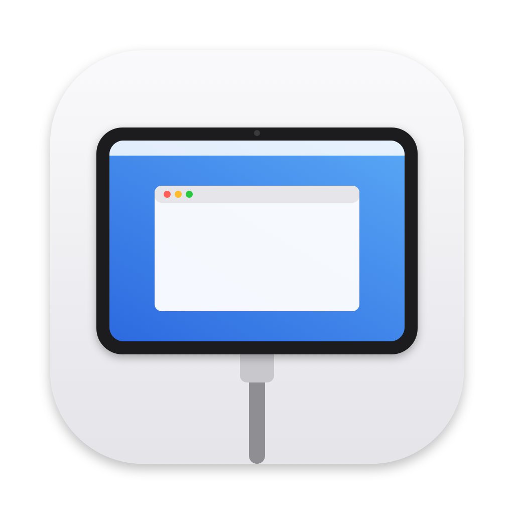

<p align="center"></p>

<h1 align="center">AutoSidecar</h1>

Plug your iPad into your Mac with a cable and it becomes a second display automatically. Unplug it and Sidecar stops automatically.

A small menu bar app for macOS.

## Install

1. Download `AutoSidecar-x.y.z.zip` from [Releases](https://github.com/abhijitreddy2009/AutoSidecar/releases/latest) and unzip it.
2. Move **AutoSidecar.app** to `/Applications`.
3. The app isn't notarized, so macOS blocks it the first time. Either right-click the app → **Open** → **Open**, or run:

   ```sh
   xattr -dr com.apple.quarantine "/Applications/AutoSidecar.app"
   ```

An iPad icon appears in the menu bar. Turn on **Launch at Login** from its menu if you want it running all the time.

## Use

Plug in the iPad. That's it.

The menu shows what's happening and has a manual switch:

```
marss — Connected
──────────────────
Disconnect
──────────────────
✓ Connect Automatically
  Launch at Login
──────────────────
Quit AutoSidecar
```

- **Connect Automatically** off: the app does nothing until you press **Connect**.
- If you turn Sidecar off yourself while the cable is in, the app leaves it off until you plug the iPad in again.

## Requirements

- A Mac and iPad that [support Sidecar](https://support.apple.com/en-us/102597), signed in to the same Apple Account.
- macOS 14 or later. Tested on macOS 27 with an iPad Air (4th generation).
- A USB data cable (not charge-only). A USB 3 cable is better; the menu warns you when the cable runs at USB 2 speed.

## How it works

| Piece | What it does |
|---|---|
| `USBMonitor` | IOKit hot-plug notifications for the iPad on USB. No polling. |
| `SidecarController` | Starts and stops Sidecar through macOS's own `SidecarCore` framework, the same calls System Settings makes. |
| `DisplayObserver` | Treats the Sidecar screen appearing or disappearing as the truth about whether Sidecar is running. |
| `SidecarReducer` | A pure state machine that decides when to connect or disconnect. Covered by unit tests. |

Details that came from testing on real hardware:

- Starting wired Sidecar makes the iPad drop off USB for about 150 ms. The app only treats the iPad as unplugged after it has been gone for 1.5 s.
- macOS sometimes ends a brand-new wired session within a second (`SidecarErrorDomain -101`). The app retries up to three times.

## Limitations

- `SidecarCore` is a private Apple framework. A future macOS update could change it. If that happens, the menu shows "Sidecar isn't available on this Mac".
- The app stops Sidecar whenever the cable is out, so it never runs over Wi-Fi. While the cable is in, macOS chooses how to connect.
- With several iPads, it uses the first one macOS offers.

## Build from source

Needs Xcode 16 or later (Swift 6 toolchain).

```sh
git clone https://github.com/abhijitreddy2009/AutoSidecar.git
cd AutoSidecar
swift test                 # state machine tests
./bundle.sh --install      # build and copy to /Applications
./bundle.sh --release      # universal zip for a GitHub release
swift tools/make-icon.swift # redraw the app icon
```

## Troubleshooting

See what the app is doing:

```sh
log stream --predicate 'subsystem == "io.github.abhijitreddy2009.AutoSidecar"'
```

- **"iPad not available"**: unlock the iPad, check that both devices use the same Apple Account, and turn on Bluetooth and Handoff on both.
- **Connects, then drops**: try a USB 3 data cable.

## License

[MIT](LICENSE)
